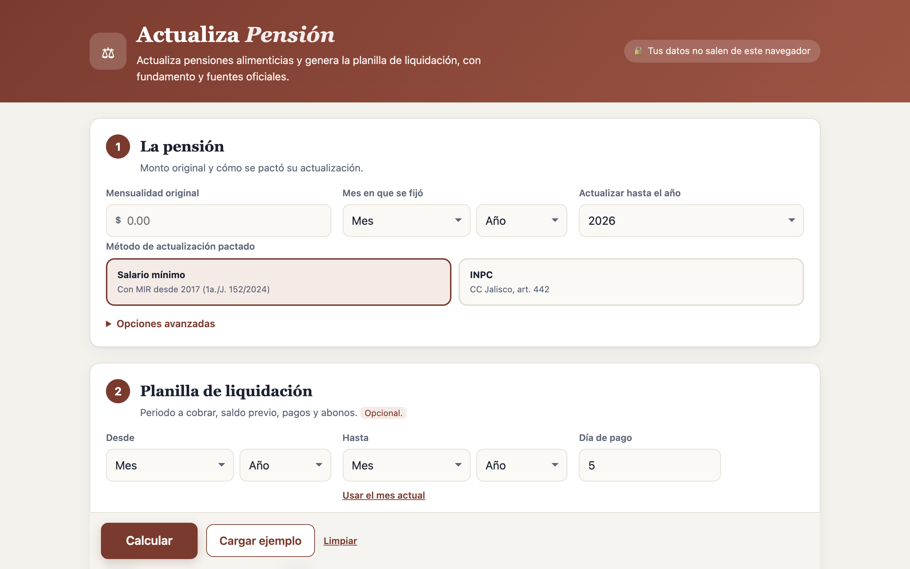
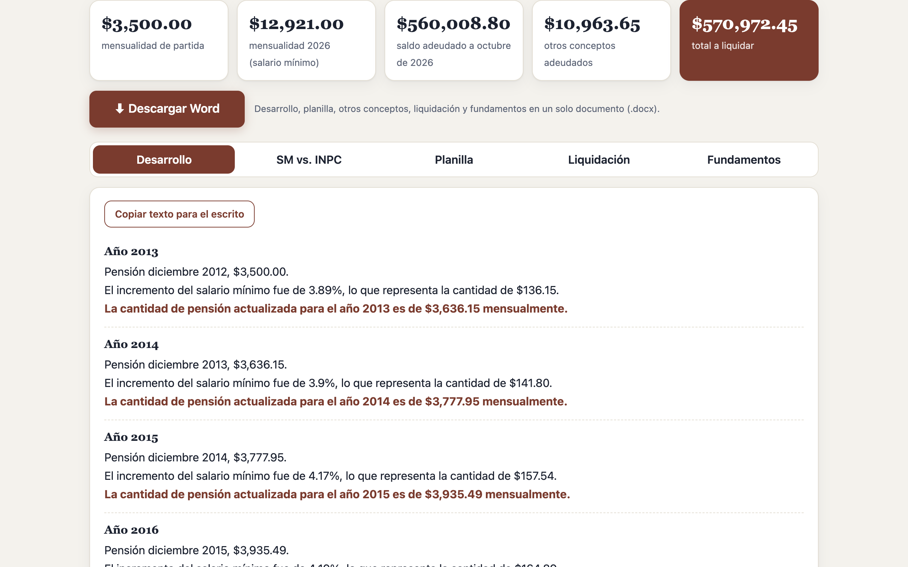
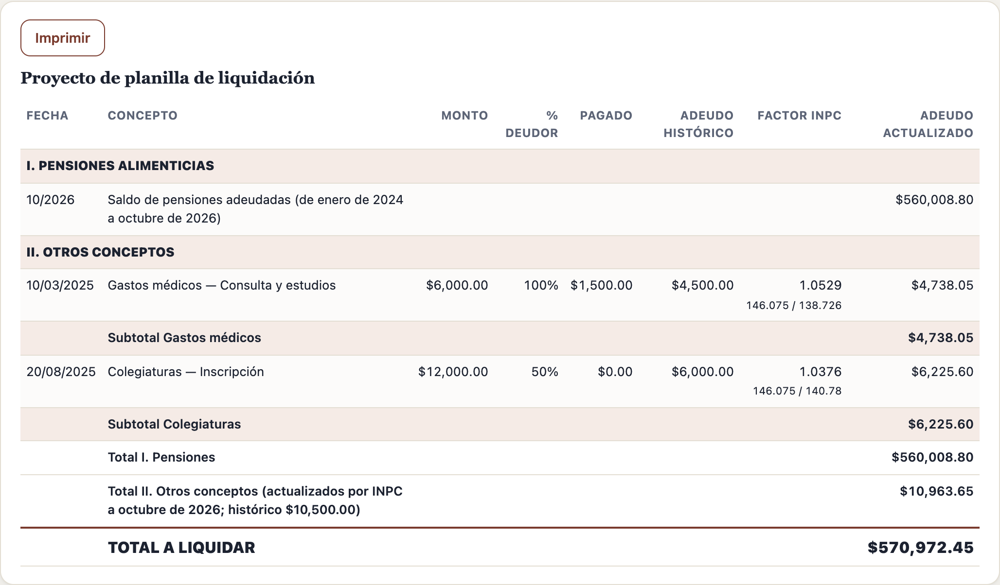
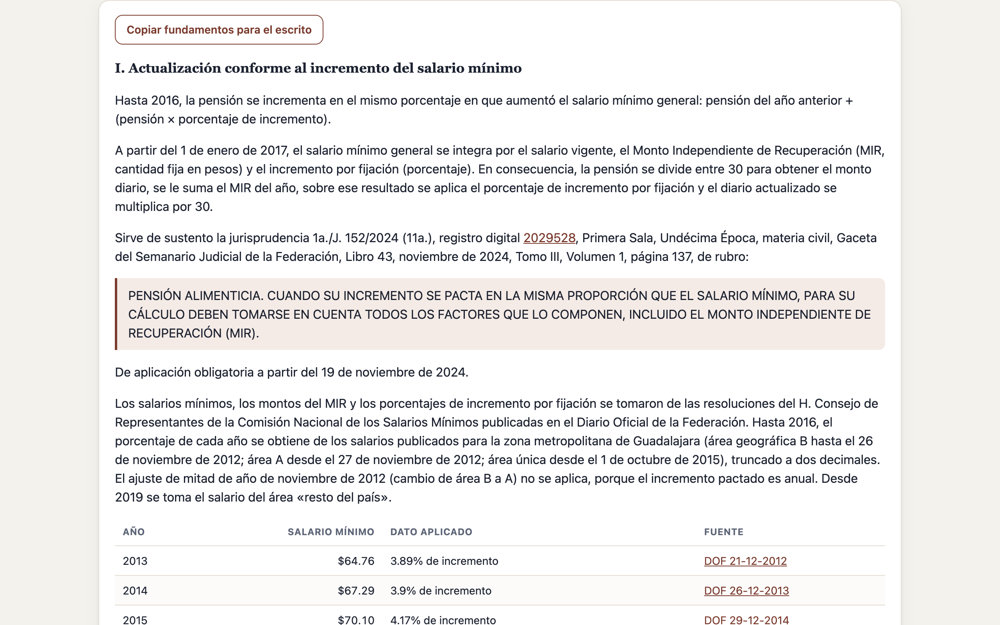

# ⚖️ Actualiza Pensión

**Actualiza pensiones alimenticias y genera la planilla de liquidación en minutos, con fundamento jurídico y fuentes oficiales verificables.**

🔗 **Pruébala en línea:** https://enriquesilva02-oss.github.io/hackathon-Claude-Lawgic-Enrique/
🎬 **Video tutorial (4 min):** [docs/video/tutorial-actualiza-pension.mp4](docs/video/tutorial-actualiza-pension.mp4)
🗣️ **Presentación para el hackathon:** [docs/PRESENTACION.md](docs/PRESENTACION.md)

Proyecto del hackathon **Claude × Lawgic**. Lo creó el Lic. Enrique Silva (abogado litigante en Jalisco) con su agente legal construido sobre Claude.



---

## El problema

En los juicios de alimentos hay que calcular, año por año, cuánto debió aumentar una pensión fijada hace 10 o 15 años, y cuánto adeuda el deudor. Hoy ese cálculo se hace a mano o en hojas de Excel, y es fácil equivocarse:

- **Datos equivocados.** Los porcentajes y montos del salario mínimo se copian de memoria o de tablas no oficiales. Un solo dato mal tomado se arrastra a todos los años siguientes.
- **Cambio de 2017.** Desde ese año el salario mínimo incluye el **Monto Independiente de Recuperación (MIR)**. La Suprema Corte resolvió en 2024 que debe tomarse en cuenta (jurisprudencia 1a./J. 152/2024), pero muchas liquidaciones lo omiten o lo aplican mal.
- **Falta de soporte.** Las planillas no citan la fuente de cada dato, y la contraparte puede objetarlas.

## La solución

Una aplicación web, gratuita y privada, que:

1. **Actualiza la pensión** por cualquiera de los dos métodos:
   - **Salario mínimo:**
     - hasta 2016, con el porcentaje anual de incremento;
     - desde 2017, con el MIR más el incremento por fijación, conforme a la jurisprudencia 1a./J. 152/2024 (11a.), registro digital 2029528.
   - **INPC:** conforme al art. 442 del Código Civil del Estado de Jalisco.
2. **Genera la planilla de liquidación** mes por mes:
   - saldo inicial (por ejemplo, una liquidación previa);
   - abonos y billetes de depósito;
   - **pagos hechos sin actualizar**, cobrando solo la diferencia.
3. **Liquida otros conceptos** (colegiaturas, gastos médicos, uniformes):
   - con el porcentaje a cargo del deudor y lo que ya pagó;
   - con **actualización por INPC** opcional hasta la fecha de corte.
4. **Compara** ambos métodos año por año.
5. **Fundamenta cada número:** método, jurisprudencia, artículo aplicable y **fuente oficial de cada dato, con enlace** al Diario Oficial de la Federación o al INEGI.
6. **Exporta a Word** un documento listo para revisar y anexar: encabezado con expediente, desarrollo, planilla, liquidación y fundamentos.

| Resultados | Liquidación | Fundamentos |
|---|---|---|
|  |  |  |

## Datos oficiales, verificados uno por uno

| Archivo | Contenido | Fuente |
|---|---|---|
| `data/salario_minimo.json` | % de incremento 2010-2016 (zona metropolitana de Guadalajara); MIR y % de fijación 2017-2026 | Resoluciones del Consejo de Representantes de la CONASAMI publicadas en el DOF, con fecha y enlace por año. 2026: gob.mx/conasami |
| `data/inpc.json` | INPC mensual, enero 1969 a septiembre 2026 | INEGI, serie 910392 (índice general, base 2a. quincena de julio 2018 = 100) |
| `data/fundamentos.json` | Textos de fundamentación | Jurisprudencia verificada en el Semanario Judicial de la Federación; CC Jalisco (Congreso del Estado); CFF art. 17-A (Cámara de Diputados) |

Al verificar los datos contra el DOF aparecieron errores comunes en la práctica. Por ejemplo, un MIR de 2021 tomado de la zona fronteriza en lugar del resto del país, o un 6.97% en 2016 donde el dato oficial es 4.19%. Por eso cada año de la tabla tiene su fuente y una prueba automática exige que exista.

## Criterio de cálculo

- Todas las cantidades se manejan en centavos, sin errores de punto flotante.
- **Cada paso se trunca a 2 decimales**, conforme a la práctica forense en liquidación de alimentos.
- **Factores INPC:**
  - se calculan a 4 decimales;
  - nunca son menores a 1;
  - siguen el art. 17-A del CFF solo por analogía.

## Privacidad

La aplicación corre completa en el navegador. **Los datos que se capturan no se envían a ningún servidor ni se guardan.** El repositorio no contiene datos de clientes: el ejemplo y las pruebas usan cifras ficticias.

## Uso local

```bash
python3 -m http.server 8765
```

Abrir `http://127.0.0.1:8765/` y presionar **«Cargar ejemplo»**.

## Pruebas

```bash
npm test
```

10 pruebas con casos ficticios comprueban al centavo, contra cálculos hechos por separado:
- los dos métodos;
- la planilla;
- los pagos sin actualizar;
- otros conceptos y su actualización por INPC;
- que cada dato tenga fuente oficial.

## Estructura

```
index.html            Interfaz (4 pasos y 5 pestañas de resultados)
styles.css            Diseño (claro y oscuro, adaptable a celular)
src/engine.js         Motor de cálculo (sin dependencias)
src/app.js            Lógica de la interfaz
src/fechas.js         Selectores de fecha por día, mes y año
src/word.js           Exportación a Word (.docx)
data/                 Tablas oficiales y fundamentos
vendor/docx.umd.js    Biblioteca docx 8.5.0 (MIT) para generar el Word
tests/                Pruebas automáticas
docs/                 Capturas, video y presentación
```

## Aviso

Herramienta de apoyo para abogados. Revise el resultado y sus fundamentos antes de presentarlo ante un tribunal.
